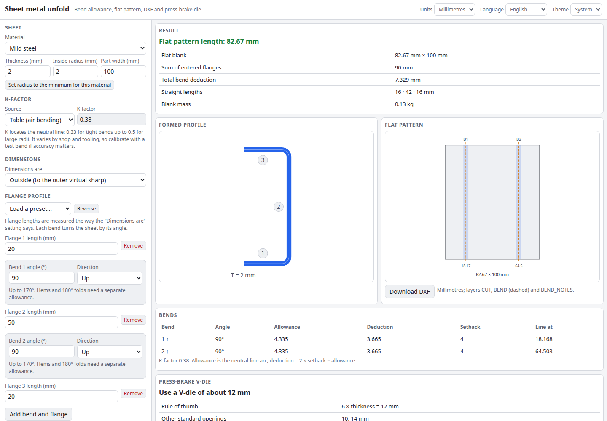

# Sheet Metal Unfold

Bend allowance and flat pattern calculator for sheet metal. Enter the thickness, inside radius and material, sketch a flange profile as a sequence of lengths and bend angles, and get the flat pattern length, bend line positions, a DXF with dashed bend lines and a press-brake V-die suggestion. Everything runs in your browser.

**Try it: [hermes98761234.github.io/sheet-metal-unfold](https://hermes98761234.github.io/sheet-metal-unfold/)**

[](https://github.com/hermes98761234/sheet-metal-unfold/actions/workflows/deploy.yml)



## Features

- **Bend allowance, deduction and setback** for any bend angle up to 170°, per bend.
- **K-factor tables** for air bending (soft, medium and hard materials by R/T ratio), a manual K, and a **test-bend calibrator** that recovers K from a measured flat length.
- **Flange profile editor**: a list of flange lengths joined by bends with angle and up/down direction. Presets for L, U, Z, hat and C channels and a 45° offset.
- **Three dimensioning conventions**: outside (to the outer virtual sharp), inside, or straight tangent-to-tangent lengths.
- **Flat pattern**: total length, straight sections, bend line positions, blank mass, drawn to scale next to the formed cross-section.
- **DXF export** (R12 ASCII, millimetres) with CUT outline, dashed BEND lines and BEND_NOTES labels.
- **Press-brake V-die suggestion**: 6T/8T/10T/12T rule, nearest standard opening, minimum flange, the radius the die forms, bending force per metre and for your part width, plus warnings for tight radii and short flanges.
- **Millimetres or inches, English or Ukrainian, light, dark or system theme.** Inputs are remembered in the browser; nothing is uploaded.

## How it works

For a bend through angle θ (0° is straight) with inside radius R, thickness T and K-factor K:

- bend allowance `BA = θ · (R + K·T)` (θ in radians),
- outside setback `OSSB = tan(θ/2) · (R + T)`, inside setback `ISSB = tan(θ/2) · R`,
- bend deduction `BD = 2·OSSB − BA`.

Each flange's straight length is its entered length minus the setbacks at its ends for the chosen convention. The flat length is the sum of the straight lengths plus the bend allowances. The bend line sits in the middle of each allowance. K can be recovered from a test coupon with `K = (BA/θ − R) / T`.

The die suggestion uses common shop rules: V = 6T up to 3 mm, 8T up to 10 mm, 10T up to 12 mm, 12T above; minimum flange about 0.7·V; natural air-bend radius about 0.16·V; force per metre `F = 1.42 · UTS · T² / V`. The K table and these rules are typical values, not a substitute for your shop's data. Confirm with a test bend before cutting production parts.

## Quick start

You need [Node.js](https://nodejs.org/) 22.

```bash
git clone https://github.com/hermes98761234/sheet-metal-unfold.git
cd sheet-metal-unfold
npm install
npm run dev       # http://localhost:5173
npm test          # bend maths, die, geometry, DXF and i18n tests
npm run build     # static site in dist/
```

## License

MIT
